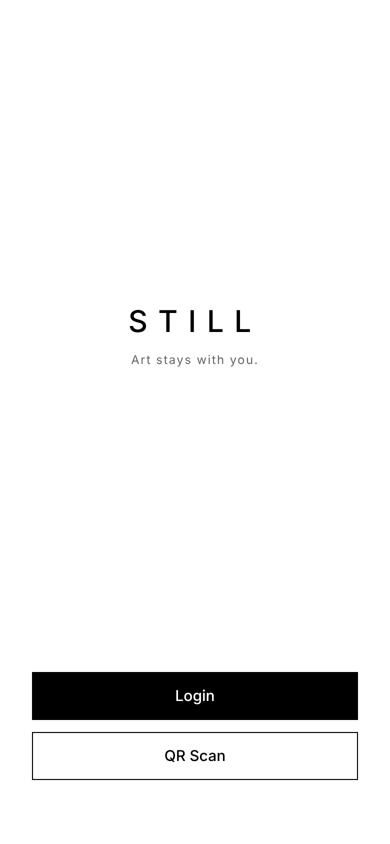
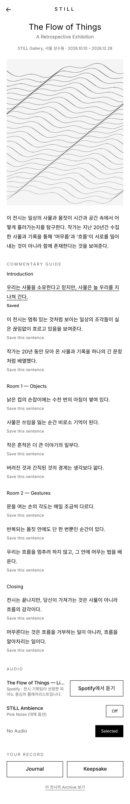
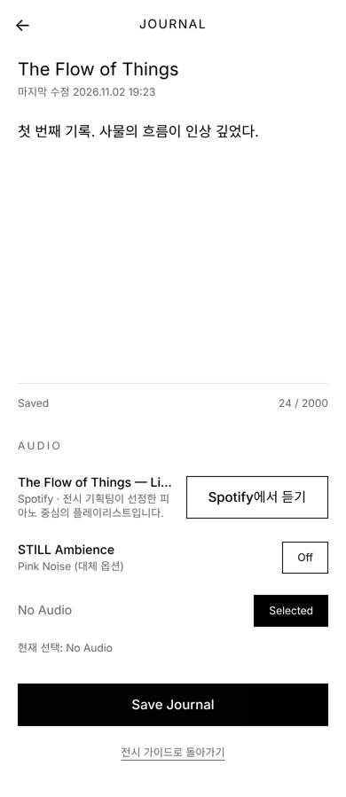
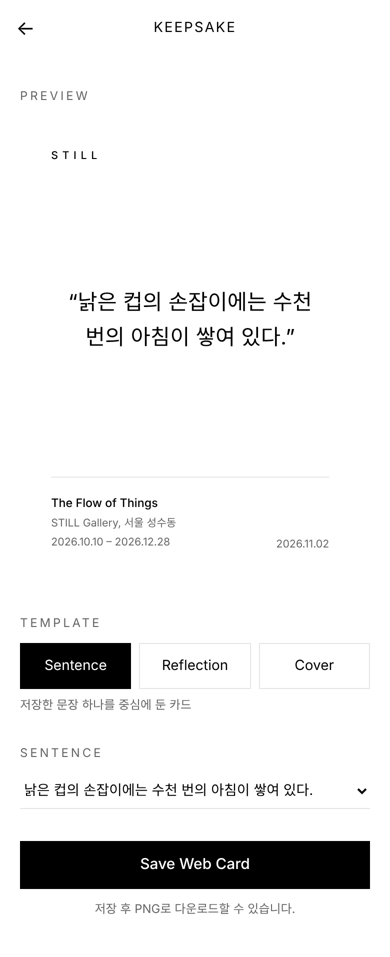
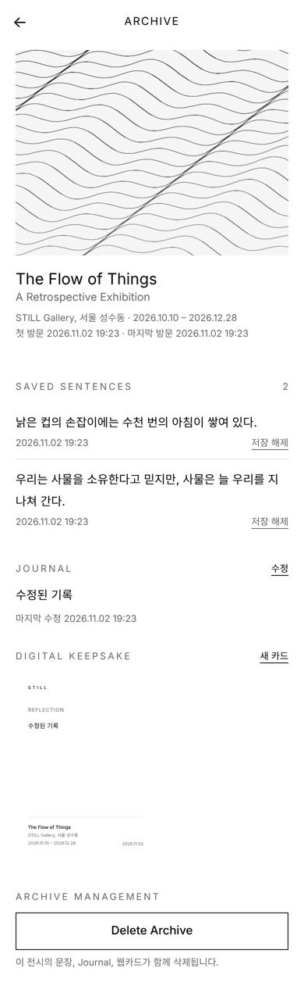
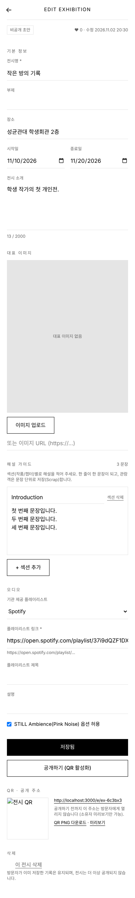
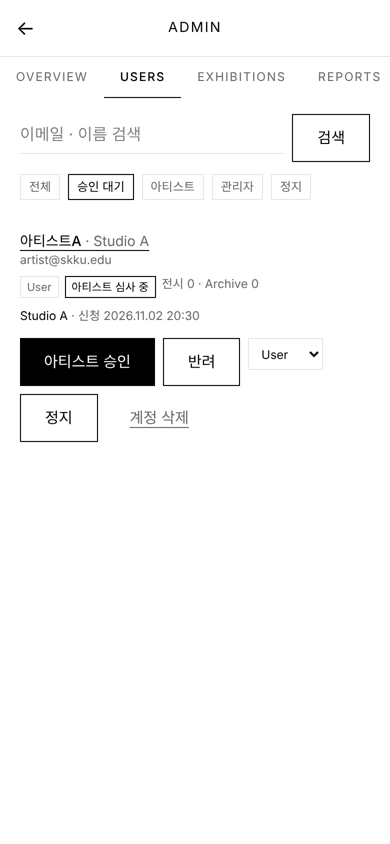

# STILL — Art stays with you.

전시를 관람하는 순간뿐 아니라 전시가 끝난 뒤에도 감상과 기억이 남도록 돕는 **모바일 전시 경험 아카이브**입니다.
QR로 전시 가이드에 들어와 인상 깊은 문장을 저장(Scrap)하고, 전시별 Journal을 쓰고, 웹카드(Digital Keepsake)로 간직합니다.

> GDG 내부 해커톤 · 2조 STILL
> 기획 문서: [docs/spec](./docs/spec) · 구현 결정 사항: [docs/DECISIONS.md](./docs/DECISIONS.md) · API: [docs/API.md](./docs/API.md) · 스펙 대조: [docs/SPEC-CHECK.md](./docs/SPEC-CHECK.md)

<p>
  
  
  
  
  
  
  
</p>

---

## 1. 빠른 시작 (3분)

```bash
git clone https://github.com/jyun-chae/still.git
cd still
npm install
npm run dev          # http://localhost:3000
```

그게 전부입니다. 첫 `npm run dev`에서 `.env`(`.env.example` 복사)와 로컬 SQLite 파일(`data/still.db`)을 만들고 샘플 전시 3개를 자동으로 넣습니다.
Google OAuth 설정 전에는 로그인 화면에 **Dev Login**(이메일만 입력)이 나오므로 바로 모든 기능을 써 볼 수 있습니다.

> 이미 클론해 둔 분: 이번 업데이트로 DB 스키마가 바뀌었습니다. `git pull` 후 **`npm run db:reset`** 한 번 실행하세요 (로컬 테스트 데이터는 지워집니다).

| 주소 | 설명 |
| --- | --- |
| `/` | Home (로그인 전/후) |
| `/dev` | **데모용** 전시 목록 + QR 코드 (휴대폰으로 스캔해 테스트) |
| `/e/flow-of-things` | 샘플 전시 — Spotify 플레이리스트 제공 |
| `/e/quiet-rooms` | 샘플 전시 — Apple Music 플레이리스트 제공 |
| `/e/traces-of-light` | 샘플 전시 — 플레이리스트 없음 → STILL Ambience(Pink Noise) |
| `/artist` | Artist Studio — 전시 등록·수정·QR (아티스트 승인 후) |
| `/admin` | 관리자 콘솔 — 사용자·아티스트 승인·전시·신고 |

### 역할별 테스트 계정 (Dev Login)

| 역할 | 방법 |
| --- | --- |
| 일반 사용자 | 로그인 화면에서 "일반 사용자" 선택 → 아무 이메일 (예: `gdg@gmail.com` / `홍길동`) |
| 아티스트 | "아티스트" 선택 → 아무 이메일 → 인증 신청 폼 제출 → 관리자가 `/admin/users`에서 승인 |
| 관리자 | `admin@still.local` 로 Dev Login (`.env`의 `ADMIN_EMAILS` 기본값). 실제 배포에서는 팀원 Gmail 주소로 바꾸세요 |

같은 이메일로 다시 로그인하면 이름은 **마지막에 입력한 값**으로 바뀝니다(비워 두면 이전 이름 유지). 개인 정보는 넣지 말고 데모용 가짜 값을 쓰세요.

휴대폰에서 테스트하려면 같은 Wi-Fi에서 `http://<내 PC IP>:3000` 으로 접속하고, `.env`에 `NEXT_PUBLIC_APP_URL=http://<내 PC IP>:3000` 을 넣으면 `/dev`의 QR이 그 주소를 가리킵니다. (카메라는 `localhost`가 아니면 HTTPS가 필요하므로 휴대폰에서는 QR 대신 URL 직접 입력을 쓰거나, `ngrok http 3000` 같은 터널을 쓰세요.)

### Google 로그인 켜기

1. [Google Cloud Console](https://console.cloud.google.com/apis/credentials) → **OAuth 클라이언트 ID 만들기** → 웹 애플리케이션
2. 승인된 리디렉션 URI에 `http://localhost:3000/api/auth/callback/google` 추가 (배포 시 배포 도메인도 추가)
3. `.env` 작성:

```bash
cp .env.example .env
# AUTH_SECRET=      ← openssl rand -base64 32
# AUTH_GOOGLE_ID=
# AUTH_GOOGLE_SECRET=
```

Google이 설정되면 Dev Login은 자동으로 숨겨집니다(개발 중 둘 다 쓰려면 `ENABLE_DEV_LOGIN=true`).

---

## 2. 기술 스택

| 영역 | 선택 | 이유 |
| --- | --- | --- |
| 프레임워크 | **Next.js 15** (App Router) + TypeScript | 레포 하나로 화면·API·DB. Vercel 배포 한 번에 끝 |
| 스타일 | **Tailwind CSS v4** | UI 담당자가 클래스만 손보면 됨. 디자인 토큰은 `globals.css` 한 곳 |
| DB / ORM | **SQLite(libsql) + Drizzle ORM** | 설치 0, 클론 후 바로 실행. 배포 시 환경변수만 바꿔 Turso(호스팅 SQLite)로 전환 |
| 인증 | **Auth.js v5** (Google OAuth, JWT 세션) | PRD 요구: Google 로그인만 지원. 역할(USER/ARTIST/ADMIN)은 DB에 두어 재로그인 없이 반영 |
| QR | `BarcodeDetector` API → 폴백 `jsqr` | 카메라 권한 거부 시 URL 직접 입력 |
| PNG | `html-to-image` (클라이언트) | 웹카드 DOM 그대로 3배 해상도(1080×1440) 래스터라이즈 → 웹카드 = PNG |
| Pink Noise | Web Audio API로 합성 | 오디오 파일 없음. 기본 Off, 사용자 제스처로만 시작 |

---

## 3. 프로젝트 구조

```
src/
├── app/                         # 라우트 (화면 + API)
│   ├── page.tsx                 # 01/02 Home (로그인 전/후)
│   ├── login/                   # Google OAuth / Dev Login
│   ├── scan/                    # 03 QR Scanner
│   ├── e/[slug]/                # 04 Exhibition Guide  ← QR/URL 진입점
│   │   ├── journal/             # 05 Journal
│   │   └── keepsake/            # 06 Digital Keepsake 만들기
│   ├── keepsake/[id]/           #    저장된 웹카드 · PNG 다운로드
│   ├── archive/                 # 07 My Archive Grid
│   │   └── [id]/                # 08 Archive Detail (삭제 포함)
│   ├── account/                 # 09 Account (+ 아티스트/관리자 진입)
│   ├── artist/                  # Artist Studio: apply, 대시보드, exhibitions/new, exhibitions/[id]
│   ├── admin/                   # 관리자 콘솔: overview, users, exhibitions, reports
│   ├── dev/                     # 데모 도우미 (전시 목록 + QR)
│   └── api/                     # REST API (docs/API.md)
├── components/
│   ├── ui/index.tsx             # ★ 버튼·헤더·다이얼로그 등 공통 UI 프리미티브
│   ├── KeepsakeCard.tsx         # ★ 웹카드 템플릿 3종 (미리보기·저장본·PNG 공용)
│   ├── audio/                   # AudioProvider(전역 상태), pink-noise 엔진, AudioOptions 패널
│   ├── exhibition/ExhibitionGuide.tsx, LikeReportBar.tsx
│   ├── artist/ExhibitionEditor.tsx, ArtistDashboard.tsx, ArtistApplyForm.tsx, ImageUpload.tsx
│   ├── admin/Admin*.tsx
│   ├── journal/JournalEditor.tsx
│   ├── keepsake/KeepsakeCreator.tsx, KeepsakeViewer.tsx
│   ├── archive/ArchiveDetail.tsx
│   ├── account/AccountPanel.tsx
│   ├── auth/LoginForm.tsx
│   └── QrScanner.tsx
├── lib/
│   ├── api.ts                   # 서버: 에러 포맷, requireUser, handler 래퍼
│   ├── archives.ts              # 서버: Archive 생성/중복 방지, Journal upsert, cascade delete
│   ├── exhibitions.ts           # 서버: 전시/가이드/오디오 조회, 공개 여부 규칙
│   ├── artist.ts                # 서버: 전시 생성/수정/공개, 가이드 diff, 아티스트 신청
│   ├── moderation.ts            # 서버: 좋아요, 신고, 관리자 조회/처리
│   ├── keepsake-templates.ts    # 템플릿 정의 + 콘텐츠 검증 (클라/서버 공용)
│   ├── format.ts
│   └── client/                  # 클라이언트 전용
│       ├── fetcher.ts           # fetch 래퍼 (ApiError)
│       ├── pending-action.ts    # ★ 로그인 중단 → 복귀(resume) 메커니즘
│       ├── drafts.ts            # Journal/Keepsake 임시 저장
│       ├── use-require-login.ts # 저장 직전 로그인 게이트 훅
│       ├── export-png.ts        # 웹카드 → PNG
│       └── analytics.ts        # track() 이벤트 훅 (dataLayer)
├── db/
│   ├── schema.ts                # Drizzle 스키마 (UNIQUE/cascade 제약 포함)
│   ├── index.ts                 # DB 클라이언트
│   └── seed.ts                  # 샘플 전시 3개
└── auth.ts                      # Auth.js 설정
```

★ = UI 작업 시 가장 먼저 열어볼 파일

---

## 4. UI 담당자 가이드

기능은 전부 붙어 있고 **룩앤필은 의도적으로 최소화**했습니다. 흑백 톤과 폰트만 PRD 기준으로 잡아 두었습니다.

- **디자인 토큰**: `src/app/globals.css`의 `@theme` 블록 — `--color-paper / --color-ink / --color-muted / --color-line`, `--font-display`(Montserrat) / `--font-body`(DM Sans). 유틸리티 클래스 `bg-paper`, `text-ink`, `text-muted`, `font-display`로 전체에서 사용 중.
- **공통 컴포넌트**: `src/components/ui/index.tsx` — `Button`, `LinkButton`, `PageHeader`, `BottomNav`, `Dialog`, `Notice`, `EmptyState`, `SectionTitle`, `Wordmark`. 여기만 바꿔도 대부분의 화면이 바뀝니다.
- **웹카드 템플릿**: `src/components/KeepsakeCard.tsx` — 카드는 360×480px 고정(3:4), PNG는 3배 해상도. 이 컴포넌트 하나가 미리보기/저장본/PNG에 모두 쓰이므로 여기만 수정하면 셋이 같이 바뀝니다. 외부 이미지는 `crossOrigin` 때문에 같은 도메인(`/public`)에 두세요. **전시별 색상·서체**는 `--ks-bg / --ks-fg / --ks-accent / --ks-font` 변수로 들어오므로 템플릿은 이 변수만 쓰면 됩니다.
- **전시 아이덴티티**: 각 전시에 `theme`(배경·글자·포인트 색 + 서체)이 있고, 가이드 화면 `<article class="exhibition-themed">`에 `--ex-bg / --ex-fg / --ex-accent / --ex-font`로 노출됩니다. 기본값은 STILL 흑백이고, 샘플 전시 3개는 각각 다른 테마를 갖고 있습니다.
- **화면별 마크업**: 각 화면 컴포넌트의 JSX는 상태 로직과 분리되어 있으니 className만 바꾸면 됩니다. `role`/`aria-*` 속성은 테스트가 의존하니 유지해 주세요.
- 폰트는 `src/app/layout.tsx`의 Google Fonts `<link>`로 로드합니다. Futura를 쓸 수 있으면 `--font-display`만 교체.

---

## 5. 스크립트

| 명령 | 설명 |
| --- | --- |
| `npm run dev` | 개발 서버 (DB 없으면 자동 생성 + 시드) |
| `npm run build` / `npm start` | 프로덕션 빌드 / 실행 |
| `npm run lint` / `npm run typecheck` | ESLint / `tsc --noEmit` |
| `npm run db:push` | 스키마를 DB에 반영 (`drizzle-kit push`) |
| `npm run db:seed` | 샘플 전시 넣기 (slug 기준 upsert, 사용자 기록은 유지) |
| `npm run db:reset` | DB 삭제 후 재생성 + 시드 |
| `npm run db:studio` | Drizzle Studio (브라우저에서 테이블 보기) |

전시 콘텐츠를 바꾸려면 `src/db/seed.ts`를 수정하고 `npm run db:seed`. (MVP 범위상 CMS는 없습니다.)

---

## 6. 역할과 권한

| 역할 | 할 수 있는 것 |
| --- | --- |
| Guest (비로그인) | 공개 전시 가이드 열람, 오디오 |
| USER | + 개인 Archive(Scrap·Journal·Keepsake), 좋아요, 신고 |
| ARTIST (관리자 승인) | + 내 전시 등록·수정·공개/비공개·삭제, 해설 가이드 작성, 대표 이미지 업로드, QR 발급 |
| ADMIN | + 사용자 관리(아티스트 승인/반려, 역할, 정지, 삭제), 모든 전시 관리(숨김/공개/삭제), 신고 처리 |

- 로그인 화면에서 **계정 유형**을 고릅니다. 일반 사용자는 바로 로그인, 아티스트는 로그인 후 인증 신청 폼으로 이동하고 관리자가 승인해야 Artist Studio가 열립니다.
- 전시 상태: `DRAFT`(초안, 비공개) → `ACTIVE`(공개, QR 동작) / `HIDDEN`(관리자 숨김, 소유자는 재공개 불가) / `DELETED`(소프트 삭제, 방문자 기록은 유지).
- 정지된(SUSPENDED) 계정은 로그인은 되지만 저장·좋아요·신고·전시 관리가 막히고, 그 아티스트의 전시는 방문자에게 보이지 않습니다.
- 신고 처리 옵션: 전시 숨김 / 전시 숨김 + 아티스트 정지 / 조치 없이 종료 / 기각. 같은 전시의 다른 미처리 신고는 함께 종료됩니다.
- 관리자 부여: `.env`의 `ADMIN_EMAILS`에 적힌 이메일로 로그인하면 자동, 또는 `/admin/users`에서 역할 변경.

## 7. 핵심 동작 (스펙 ↔ 구현)

| 규칙 | 구현 위치 |
| --- | --- |
| CORE-01 비로그인 가이드 열람 | `/e/[slug]` 서버 렌더, 로그인 불필요 |
| CORE-02 저장 시 로그인 → **원래 작업으로 복귀** | `lib/client/pending-action.ts` + 각 화면의 `consumePendingAction()`; Journal/Keepsake 초안은 `drafts.ts` |
| CORE-03 Archive는 user×exhibition당 1개 | `archives` UNIQUE(user_id, exhibition_id) + `getOrCreateArchive()`; 재방문 시 `last_visited_at` 갱신 |
| CORE-04 Archive당 Journal 1개 | `journals.archive_id` UNIQUE + `PUT /archives/{id}/journal` upsert |
| CORE-05 가이드 문장만 Scrap | `scraps.guide_sentence_id` → 전시 소속 검증, `sentence_content_snapshot` 보존, UNIQUE(archive, sentence) |
| CORE-06/07 플레이리스트 없으면 Pink Noise, 기본 Off | `GET /exhibitions/{id}/audio` 의 `mode`, `components/audio/*` |
| CORE-08 웹카드 저장 + PNG | `KeepsakeCard` + `export-png.ts` (1080×1440 PNG). 전시당 1장(다시 저장 = 교체), 전시 테마 적용 |
| CORE-09 Archive 삭제 시 연쇄 삭제 | `deleteArchive()` 트랜잭션 + FK cascade |
| 권한 | 모든 개인 데이터 API는 소유자 검증(403), 로그인 없으면 401 |

---

## 8. 배포 (Vercel + Turso)

1. [Turso](https://turso.tech)에서 DB 생성 → URL(`libsql://…`)과 토큰 복사
2. 로컬 `.env`의 **기존 `DATABASE_URL=file:./data/still.db` 줄을 고쳐서**(아래에 새 줄을 추가하지 말고) 원격 DB를 가리키게 한 뒤 스키마/시드:
   ```
   DATABASE_URL=libsql://<db>.turso.io
   DATABASE_AUTH_TOKEN=<token>
   ```
   ```bash
   npm run setup        # drizzle-kit push + seed → 원격 DB에 테이블·샘플 전시 3개
   ```
   (Windows에서 한 줄 명령 대신 이렇게 `.env`를 쓰는 편이 안전합니다. 로컬 파일 DB로 돌아가려면 두 줄을 원래대로.)
3. Vercel에 레포 연결, 환경변수 입력: `DATABASE_URL`, `DATABASE_AUTH_TOKEN`, `AUTH_SECRET`(배포 환경 필수, 32자 이상 랜덤), `NEXT_PUBLIC_APP_URL=https://<도메인>`, `ADMIN_EMAILS=<관리자 이메일>`, 그리고 `AUTH_GOOGLE_ID`/`AUTH_GOOGLE_SECRET` 또는 데모용 `ENABLE_DEV_LOGIN=true`
4. (Google 로그인 시) Google Cloud 리디렉션 URI에 `https://<도메인>/api/auth/callback/google` 추가
5. 환경변수를 바꿨으면 **Redeploy** (빌드 시점에 반영됨)

프로덕션에서 Dev Login은 `ENABLE_DEV_LOGIN=true`를 명시하지 않는 한 꺼져 있습니다.

**`/login?error=Configuration`이 뜰 때**: 로그인 과정에서 서버 오류가 난 것입니다. 대부분 (a) `AUTH_SECRET` 누락, (b) 원격 DB에 테이블이 없음(2번을 안 했거나 `.env`가 로컬 파일 DB를 가리킨 채 실행), (c) `DATABASE_AUTH_TOKEN` 오류. Vercel → Deployments → 해당 배포 → **Logs**에서 실제 오류 메시지를 확인하세요.

---

## 9. 팀 작업 규칙 (제안)

- `main`은 항상 실행 가능한 상태 유지. 기능/화면 단위로 브랜치(`feat/ui-home`, `feat/keepsake-templates`) → PR.
- `.env`와 `data/*.db`는 커밋 금지(.gitignore 처리됨).
- 스키마를 바꾸면 `npm run db:push` 후 PR 설명에 적어 주세요. 팀원은 `npm run db:reset`으로 맞출 수 있습니다.
