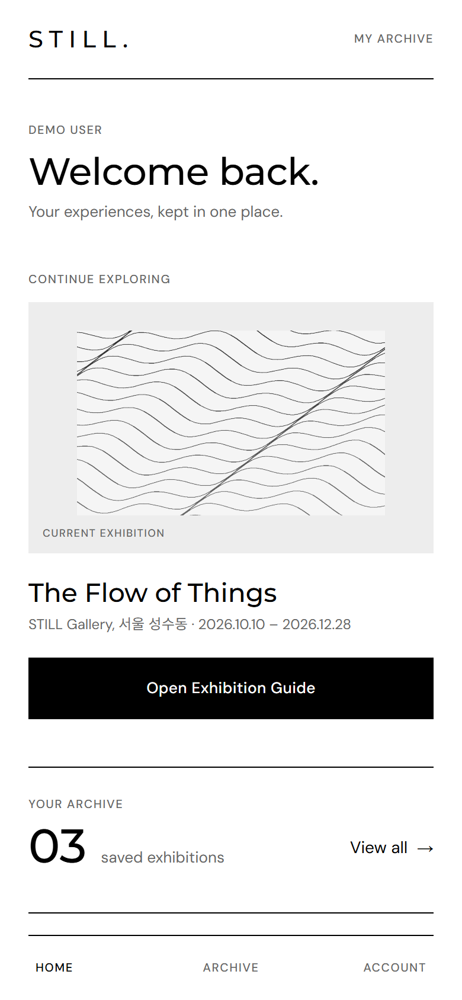
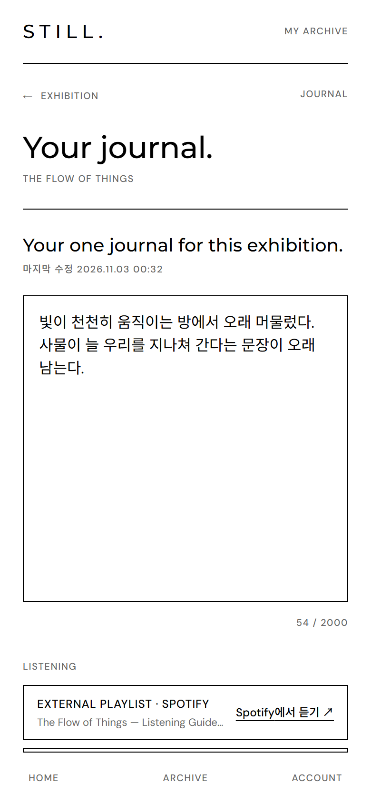
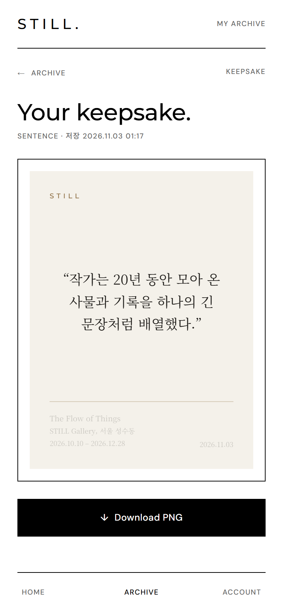
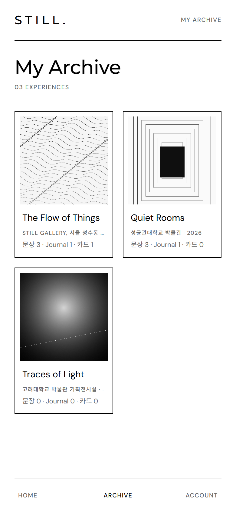

# STILL — Art stays with you.

전시를 관람하는 순간뿐 아니라 전시가 끝난 뒤에도 감상과 기억이 남도록 돕는 **개인화 전시 경험 아카이브**입니다.
STILL은 관람객의 기억이 머무는 공간을 지향합니다.

[SPEC](https://github.com/Tell-the-vision/PRD/blob/main/docs/SPEC.md) · [AGENTS.md](./AGENTS.md)

<table align="center">
  <tr>
    <td align="center"><br /><sub>Home</sub></td>
    <td align="center"><br /><sub>Exhibition Guide</sub></td>
    <td align="center"><br /><sub>Journal</sub></td>
    <td align="center"><br /><sub>Keepsake</sub></td>
    <td align="center"><br /><sub>Archive</sub></td>
  </tr>
</table>

## 제품 컨셉

**QR/URL → Exhibition Guide(로그인 시 Archive 등록) → Scrap · Journal → Archive Detail → Digital Keepsake(PNG)**

1. 전시장 QR 또는 URL로 진입해 해설 가이드를 봅니다.
2. 인상 깊은 해설 문장을 **Scrap**으로 저장합니다. 임의 문장 입력은 없습니다.
3. 전시별 **Journal**을 씁니다.
4. Archive Detail에서 **Digital Keepsake**를 만듭니다. 전시 커버 이미지와 전시 정보, 개인 기록(Scrap·Journal 발췌)을 담은 흑백 웹카드를 저장한 뒤 PNG로 소장합니다. 진입점과 세부는 미결정 3·4·5·6입니다.
5. 모든 기록은 전시별 **Archive**에 쌓입니다.

Audio(External Playlist / Pink Noise / NO AUDIO, P1)는 Guide와 Journal에 있습니다. Pink Noise는 Journal에서만, 기본 Off입니다.
범위 밖: 소셜·공유, 결제, 관리자 CMS UI, 생성형 AI 카드 이미지(로드맵), 3D/VR.

## 아키텍처 결정

- 웹·iOS·Android를 **Expo 단일 코드베이스**로 만듭니다. 웹은 Expo 웹 빌드(react-native-web)이며, 웹과 앱의 동작 차이는 SPEC §0.1 표에 적힌 것만 둡니다.
- 비즈니스 규칙은 **서버**에만 둡니다. 클라이언트는 복제하지 않고, 서버 상태가 없는 표현 규칙(오디오 표시 모드)만 계산합니다.
- 서버는 **Next.js**입니다. tRPC 라우터(`/api/trpc`)와, 브라우저 내비게이션·바이너리가 필요한 곳(OAuth, Keepsake PNG, 앱 링크 파일)만 Route Handler로 둡니다. DB는 PostgreSQL 15+입니다 (§0.1, §10, §11.1).
- 클라이언트와 서버는 **tRPC**로 통신합니다. 라우터 타입(`import type`만)과 zod 입력 스키마를 서버 의존성 없는 모노레포 공유 패키지에 두어 같은 검증을 씁니다.
- 웹과 API는 **같은 오리진**이라 1st-party 쿠키로 인증하고 CORS가 필요 없습니다. 쿠키 요청은 `Origin`이 STILL 오리진이어야 하고 본문은 `application/json`만 받으며 별도 CSRF 토큰은 없습니다. 앱은 bearer 액세스 토큰과 보안 저장소의 회전 refresh 토큰을 쓰고, 로그인은 임베디드 웹뷰 없이 OS 인증 세션 + PKCE를 씁니다 (§2.1, §2.3, §11.4).
- 공개 응답에는 사용자별 정보가 없어 전시·가이드를 인증 없이 CDN에 캐시하고, 개인 데이터는 `private, no-store`로 응답합니다. 전시·가이드 이미지는 R2 공개 버킷에서 서명 없이 불변 캐시로 제공합니다. 소유자 전용 Keepsake PNG만 `keepsake.get`의 `png.url`(단기 HMAC ticket, MVP 유일한 서명 URL)로 엽니다. PNG 생성·저장 방식은 미결정 6입니다 (§7.3, §11.7).
- 쓰기 API는 `upsert`·`delete`를 멱등으로 두고(예외: 마지막 연결 해제), 중복은 DB 제약으로 막습니다. Journal만 `revision`으로 낙관적 동시성을 씁니다. 스냅샷은 클라이언트 값이 아니라 서버가 원본에서 구성합니다 (§5.3, §11.1, §11.4).
- 스토어 배포로 구버전 앱이 오래 공존하므로 입력은 선택 필드 추가만, 출력은 필드 추가만 허용하고(클라이언트는 모르는 enum 값을 견딥니다), 깨지는 변경은 새 프로시저 이름으로 냅니다 (§11.1).
- 인쇄된 QR 하나로 어디서든 같은 전시가 열리도록, 앱이 설치되어 있으면 OS 링크로 `/e/*`를 앱에서 열고 없으면 웹 가이드가 열립니다.

## 핵심 규칙

- **Guest**는 Home, QR, Exhibition Guide, Audio 재생·선택을 쓰고 Journal은 로컬 Draft까지 씁니다. Save하면 로그인 후 Draft가 한 번 저장됩니다 (열 때 로그인 여부는 미결정 11).
- 그 밖의 기록 기능과 Audio Settings는 로그인(MVP는 Google)이 필요하고, 로그인 후 하던 동작을 이어갑니다.
- 첫 로그인 시 약관·방침 동의, 개인 기록은 본인에게만 보이며, 앱·웹에서 계정 삭제 시 모든 기록이 삭제됩니다 (세부는 미결정 12·13).
- Scrap 저장과 해제는 **멱등**입니다.
- Guide에서 한 번 Saved된 문장은 Saved로 유지되고, 해제는 Archive Detail에서만 합니다.
- Scrap 문장과 Keepsake의 개인 기록은 저장 시점의 **스냅샷**입니다. 전시 정보와 커버 이미지는 현재 값을 씁니다.
- Archive, Journal, Keepsake는 전시당 사용자별 하나입니다.
- Archive를 삭제하면 Scrap, Journal, Keepsake도 함께 삭제됩니다.

## 실행

```bash
npm install
npm run dev
```
