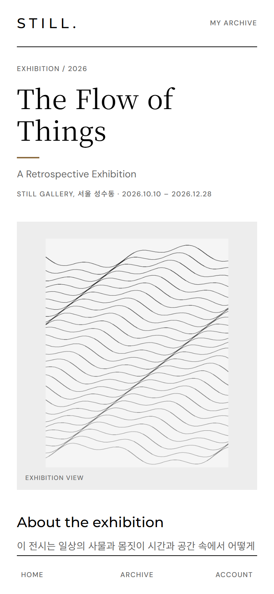
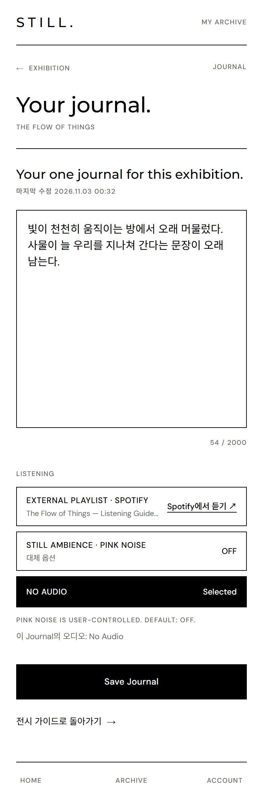
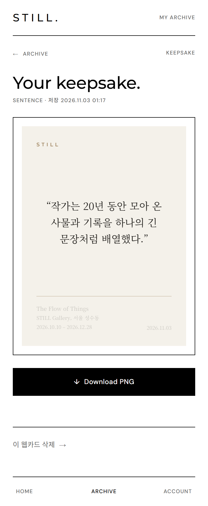

# STILL — Art stays with you.

전시를 관람하는 순간뿐 아니라 전시가 끝난 뒤에도 감상과 기억이 남도록 돕는 **모바일 전시 경험 아카이브**입니다.
QR로 전시 가이드에 들어와 인상 깊은 문장을 저장(Scrap)하고, 전시별 Journal을 쓰고, 웹카드(Digital Keepsake)로 간직합니다.

> GDG 내부 해커톤 · 2조 STILL
> 기준 스펙: [Tell-the-vision/PRD · SPEC.md](https://github.com/Tell-the-vision/PRD/blob/main/docs/SPEC.md) · 팀 규칙: [AGENTS.md](./AGENTS.md)

<table align="center">
  <tr>
    <td align="center"><br /><sub>Home</sub></td>
    <td align="center"><br /><sub>Exhibition Guide</sub></td>
    <td align="center"><br /><sub>Journal</sub></td>
    <td align="center"><br /><sub>Keepsake</sub></td>
    <td align="center"><br /><sub>Archive</sub></td>
  </tr>
</table>

## 1. 빠른 시작 (로컬)

```bash
git clone https://github.com/Tell-the-vision/still.git
cd still
# Node.js 20 이상(CI는 22)
npm install
npm run dev          # http://localhost:3000
```

그게 전부입니다. 첫 `npm run dev`(predev)에서 `.env`를 `.env.example`로부터 만들고, 로컬 SQLite 파일(`data/still.db`)을 생성해 샘플 전시 3개를 넣습니다. 외부 서비스는 필요 없습니다. 이미 `.env`가 있으면(R2 키 등) 덮어쓰지 않으니 `.env.example`의 `ADMIN_EMAILS=admin@still.local` 줄을 직접 추가하세요.
Google OAuth 설정 전에는 로그인 화면에 **Dev Login**(이메일 + 선택 이름)이 나오므로 바로 모든 기능을 써 볼 수 있습니다.

| 역할 | Dev Login 방법 |
| --- | --- |
| 일반 사용자 | "일반 사용자" 선택 → 아무 이메일 |
| 아티스트 | "아티스트 · 전시 기획자" 선택 → 아무 이메일 → 인증 신청 폼 제출 → 관리자가 `/admin/users`에서 승인 |
| 관리자 | `admin@still.local` (`ADMIN_EMAILS` 기본값) |

같은 이메일로 다시 로그인하면 이름은 마지막에 입력한 값으로 바뀝니다. 데모용 가짜 값을 쓰세요.

주요 주소: `/`(Home) · `/scan`(QR) · `/e/flow-of-things`(Spotify) · `/e/quiet-rooms`(Apple Music) · `/e/traces-of-light`(플레이리스트 없음 → Pink Noise) · `/e/<slug>/journal` · `/e/<slug>/keepsake` · `/keepsake/<id>` · `/archive` · `/account` · `/artist` · `/admin`(비로그인 → 로그인, 관리자가 아니면 404) · `/dev`(데모용 전시 목록 + QR)

- **휴대폰 테스트**: 같은 Wi-Fi에서 `http://<내 PC IP>:3000` 접속, `.env`에 `NEXT_PUBLIC_APP_URL=http://<내 PC IP>:3000`을 넣으면 `/dev`의 QR이 그 주소를 가리킵니다. 카메라는 `localhost` 외에는 HTTPS가 필요하니 URL 직접 입력이나 `ngrok http 3000`을 쓰세요.
- **Google 로그인**: Google Cloud Console에서 웹 OAuth 클라이언트를 만들고 리디렉션 URI `http://localhost:3000/api/auth/callback/google`을 추가한 뒤 `.env`에 `AUTH_GOOGLE_ID` / `AUTH_GOOGLE_SECRET`을 넣습니다. 설정되면 Dev Login은 숨겨집니다(둘 다 쓰려면 `ENABLE_DEV_LOGIN=true`).
- **Windows**: dev 서버가 `.next` 관련 `UNKNOWN: unknown error, open ...`으로 멈추면 `npm run dev -- --turbopack`으로 실행하세요(predev도 그대로 실행됨). 백신의 파일 잠금 문제로 보이며 코드 문제가 아닙니다.

`.env` 항목 설명은 [.env.example](./.env.example)에 있습니다. 업로드 이미지는 DB에 BLOB으로 저장됩니다([DECISIONS.md](./docs/DECISIONS.md)).

## 2. 기술 스택

Next.js 15.5 (App Router) + React 19 + TypeScript · Tailwind CSS v4 · SQLite(libsql) + Drizzle ORM · Auth.js v5 (Google OAuth, JWT, 역할은 DB) · QR은 `BarcodeDetector` → `jsqr` 폴백 · PNG는 `html-to-image`(1080×1440) · Pink Noise는 Web Audio 합성

## 3. 폴더 구조

```
src/
├── app/          # 라우트(화면) + api/ (REST, docs/API.md)
├── components/   # 화면별 컴포넌트 · ★ ui/index.tsx · ★ KeepsakeCard.tsx
├── lib/          # 서버 로직 · client/ (fetcher, ★ pending-action 로그인 복귀, drafts, export-png)
├── db/           # schema.ts · index.ts · seed.ts (샘플 전시)
└── auth.ts       # Auth.js 설정
```

★ = UI 작업 시 가장 먼저 열어볼 파일. 전시 콘텐츠는 `src/db/seed.ts` 수정 후 `npm run db:seed` (CMS는 없습니다).

## 4. 스크립트

| 명령 | 설명 |
| --- | --- |
| `npm run dev` | 개발 서버 (predev: `.env`·DB 없으면 생성 + 시드) |
| `npm run build` / `npm start` | 프로덕션 빌드 / 실행 (로컬 `npm start`는 `.env`에 `AUTH_SECRET`(`openssl rand -base64 32`) 필요, Google 미설정 시 `ENABLE_DEV_LOGIN=true` 필요) |
| `npm run lint` / `npm run typecheck` | ESLint / `tsc --noEmit` |
| `npm run db:push` / `db:seed` / `setup` | 스키마 반영(`drizzle-kit push --force`) / 샘플 전시 upsert / 둘 다 |
| `npm run db:reset` | 로컬 파일 DB 삭제 후 재생성 + 시드 (`file:` URL만) |
| `npm run db:studio` | Drizzle Studio |

`test` 스크립트와 CI는 아직 없습니다. CI는 [docs/ci-workflow.example.yml](./docs/ci-workflow.example.yml)을 `.github/workflows/ci.yml`로 옮기면 켜집니다.

## 5. 역할과 배포

- 역할: Guest(공개 가이드 열람) → USER(Scrap·Journal·Keepsake, 좋아요, 신고) → ARTIST(승인 후 내 전시 등록·공개·QR) → ADMIN(사용자·승인·전시·신고 관리). 전시 상태 `DRAFT / ACTIVE / HIDDEN / DELETED`, 정지(SUSPENDED) 계정은 쓰기 불가.
- 스펙 ↔ 구현 대조는 [docs/SPEC-CHECK.md](./docs/SPEC-CHECK.md), API는 [docs/API.md](./docs/API.md), 구현 결정은 [docs/DECISIONS.md](./docs/DECISIONS.md), 원문 기획은 [docs/spec](./docs/spec), Figma 적용 기록은 [docs/UI-FIGMA-PROGRESS.md](./docs/UI-FIGMA-PROGRESS.md)에 있습니다.
- **배포**: 아직 로컬 전용입니다(Vercel 프로젝트·호스팅 DB 없음). 예정 경로는 Vercel + Turso이며 아직 검증되지 않았습니다. `drizzle.config.ts`에 `dialect: "turso"`와 `authToken: process.env.DATABASE_AUTH_TOKEN`을 추가해야 `drizzle-kit push`가 Turso에 인증하고, 시드 스크립트는 `.env`를 읽지 않으니 변수를 셸에서 넘겨 실행합니다: `DATABASE_URL=libsql://… DATABASE_AUTH_TOKEN=… npm run setup`. 프로덕션에는 `AUTH_SECRET`, `AUTH_GOOGLE_*`(리디렉션 URI는 배포 도메인의 `/api/auth/callback/google`), `NEXT_PUBLIC_APP_URL`(배포 도메인)이 필요합니다. Dev Login은 `ENABLE_DEV_LOGIN=true`가 아니면 꺼집니다.

## 6. 팀 작업 규칙 ([AGENTS.md](./AGENTS.md) 기준)

- 구현은 [PRD SPEC.md](https://github.com/Tell-the-vision/PRD/blob/main/docs/SPEC.md)에 근거하고, 모호한 점은 GitHub 이슈로 올립니다. 성능보다 코드 명확성을 우선합니다.
- 서버와 클라이언트는 한 커밋에서 함께 바꾸고, 사용자가 기능에 도달함을 보여 주는 `next/experimental/testmode/playwright` 테스트를 포함합니다.
- 브랜치 이름은 `<service>/<content>` (예: `expo/monorepo-setup`). UI 작업 PR에는 완성 화면 이미지를 첨부합니다.
- `.env`와 `data/*.db`는 커밋 금지(.gitignore 처리됨). 스키마를 바꾸면 PR 설명에 적어 주세요(팀원은 `npm run db:reset`).
